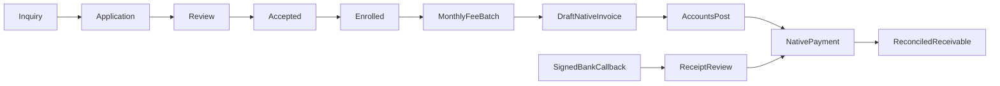

# School source scope

Two campuses under one fictional legal company; sessions, grade sections,
admission stages and required document checklist; unique numbered student records;
controlled section/campus transfer and enrollment history; recurring grade/campus
fee schedules with monthly, annual and admission categories; duplicate charge
constraints; native guardian invoices, partial/full payment and reconciliation;
student enrollment QWeb; campus-restricted records and invoices; administrative
purchase requisition approval to native RFQ; native HR/leave with campus assignment;
generic signed bank callback/receipt and native payment registration are authored.

Roles separate admissions, accounts, campus management and administrator access.
Assign Authorized School Campuses on each non-admin user's form. Teachers/staff
have read-only campus-scoped custom records. A school administrator can configure
all campuses in the allowed company. Native financial permissions are not granted
to ordinary school staff. Guardian contacts and base Odoo contact privacy need a
separate production privacy review; no public student controller is provided.

After configuring the native chart, journal and payment methods, complete the
fictional admission checklist, apply/review/accept/enroll, then create a month-first
fee batch. Invoices remain draft for accounts review. Repeated billing skips the
same charge. Use native credit notes for corrections, not edited charge history.
The bank callback contract uses HMAC SHA256/base64, signed timestamp +/-300s,
transaction ID, invoice reference, amount, date, currency and status. Configure a
dedicated accounts service user and matching bank journal, then use the supplied
loopback simulator only when you later choose to run it. Apply receipts internally.
Advances, payroll calculations, school website publication, full campus collection
dashboards and historic residual-as-of reports are outside this repository’s custom feature scope; native accounting lists/pivots, HR and website configuration are the
extension points. Exact historic version was unavailable; Odoo 18 is a demo choice.
All amounts and policies are proposed, fictional and unverified. Nothing was run.

